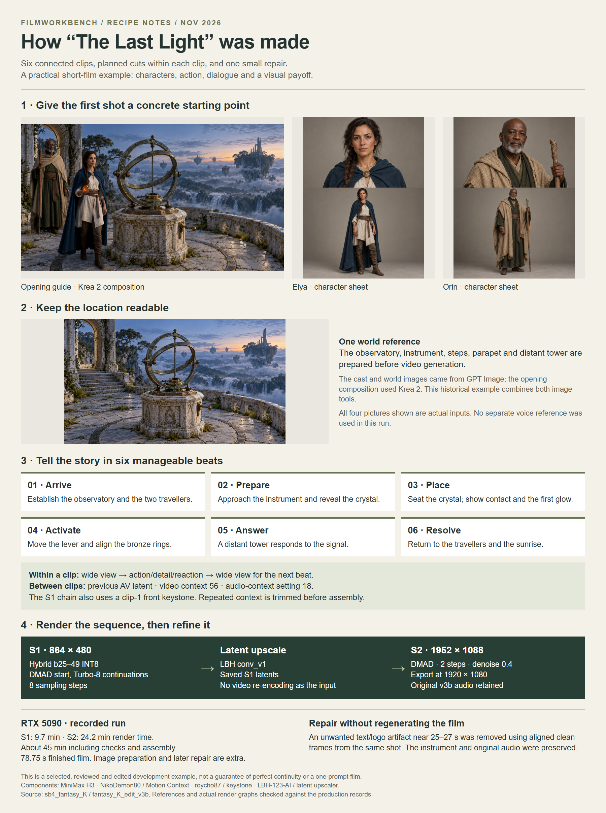

# The Last Light — six-clip Fantasy film

[Watch / download the S2 video](https://github.com/martinsommer3-oss/Filmworkbench-Starter/releases/download/v0.1.0/Filmworkbench_FANTASY_S2.mp4) · 78.75 seconds · 1920×1080

Six connected clips, prepared world and character views, and a local repair in the finished edit.

[Open the full-size overview](overview.png) · [Render graphs, settings and reference files](render-data/README.md) · [Detailed recipe](../../recipes/FANTASY.md)

The MP4 is supplied in the companion examples ZIP. Extract it into the repository root to place it beside this overview. The video link above downloads the file from this GitHub release; Git does not store the video binary.

[Local MP4 after extracting the examples ZIP](video_S2.mp4)

[Back to all examples](../README.md)
