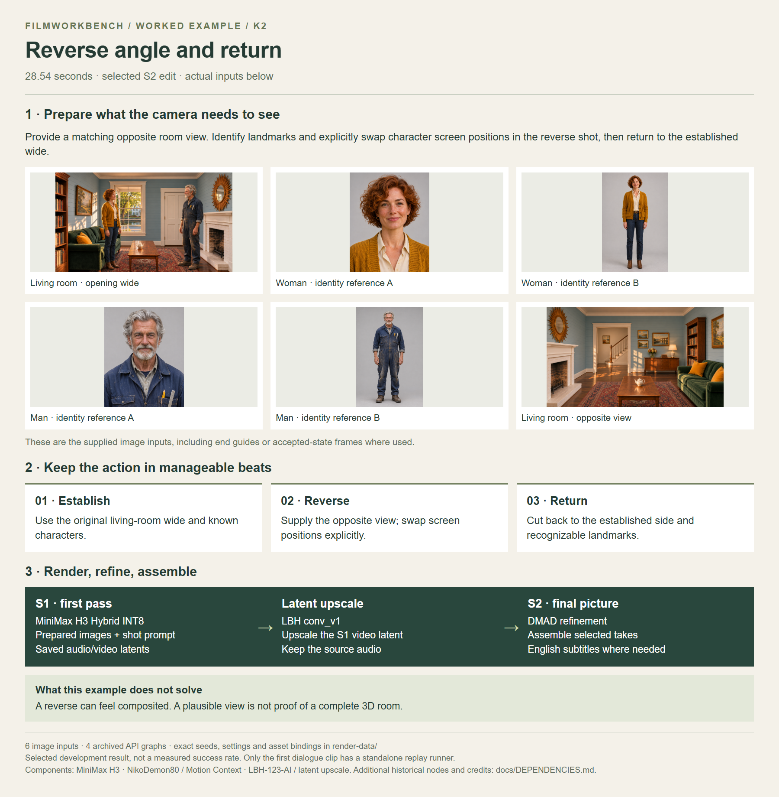

# Reverse angle and return

[Watch / download the S2 video](https://github.com/martinsommer3-oss/Filmworkbench-Starter/releases/download/v0.1.0/Filmworkbench_K2_S2.mp4) · 28.54 seconds · 1952×1088

Provide a matching opposite room view. Identify landmarks and explicitly swap character screen positions in the reverse shot, then return to the established wide.

[Open the full-size overview](overview.png) · [Render graphs, settings and reference files](render-data/README.md) · [Detailed recipe](../../recipes/K2.md)

The MP4 is supplied in the companion examples ZIP. Extract it into the repository root to place it beside this overview. The video link above downloads the file from this GitHub release; Git does not store the video binary.

[Local MP4 after extracting the examples ZIP](video_S2.mp4)

[Back to all examples](../README.md)
