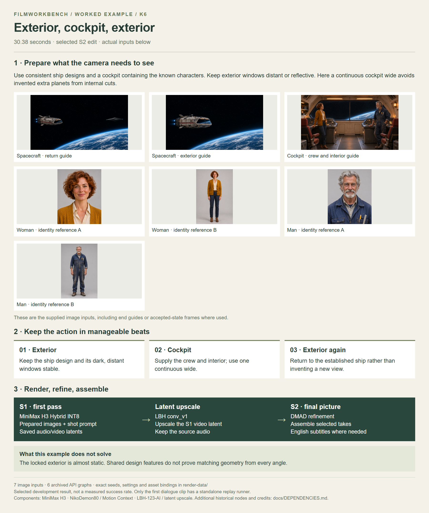

# Exterior, cockpit, exterior

[Watch / download the S2 video](https://github.com/martinsommer3-oss/Filmworkbench-Starter/releases/download/v0.1.0/Filmworkbench_K6_S2.mp4) · 30.38 seconds · 1952×1088

Use consistent ship designs and a cockpit containing the known characters. Keep exterior windows distant or reflective. Here a continuous cockpit wide avoids invented extra planets from internal cuts.

[Open the full-size overview](overview.png) · [Render graphs, settings and reference files](render-data/README.md) · [Detailed recipe](../../recipes/K6.md)

The MP4 is supplied in the companion examples ZIP. Extract it into the repository root to place it beside this overview. The video link above downloads the file from this GitHub release; Git does not store the video binary.

[Local MP4 after extracting the examples ZIP](video_S2.mp4)

[Back to all examples](../README.md)
