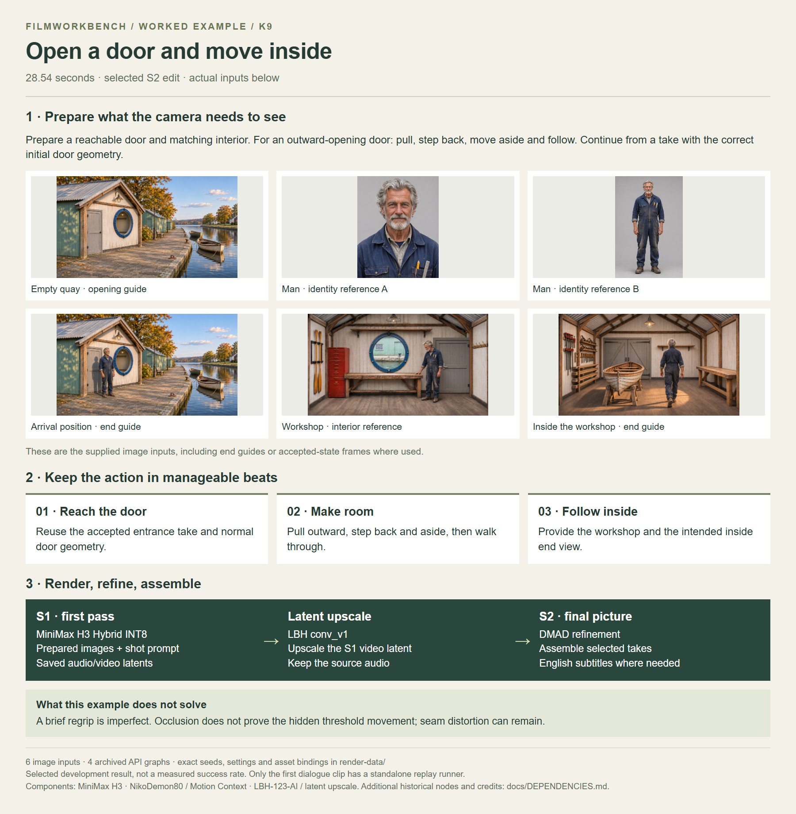

# Open a door and move inside

[Watch / download the S2 video](https://github.com/martinsommer3-oss/Filmworkbench-Starter/releases/download/v0.1.0/Filmworkbench_K9_S2.mp4) · 28.54 seconds · 1952×1088

Prepare a reachable door and matching interior. For an outward-opening door: pull, step back, move aside and follow. Continue from a take with the correct initial door geometry.

[Open the full-size overview](overview.png) · [Render graphs, settings and reference files](render-data/README.md) · [Detailed recipe](../../recipes/K9.md)

The MP4 is supplied in the companion examples ZIP. Extract it into the repository root to place it beside this overview. The video link above downloads the file from this GitHub release; Git does not store the video binary.

[Local MP4 after extracting the examples ZIP](video_S2.mp4)

[Back to all examples](../README.md)
