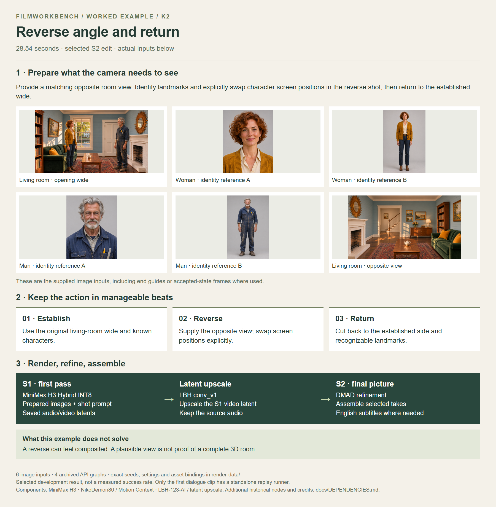
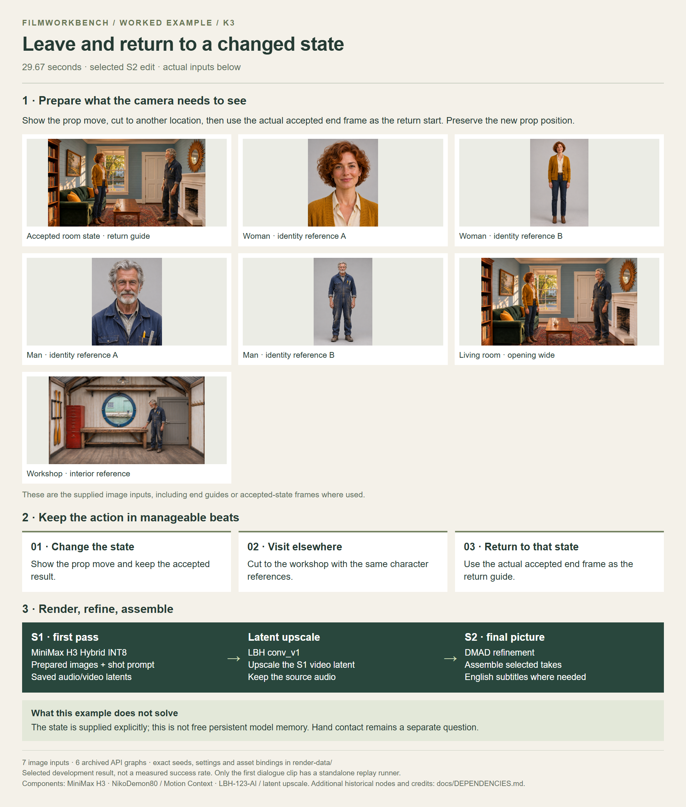
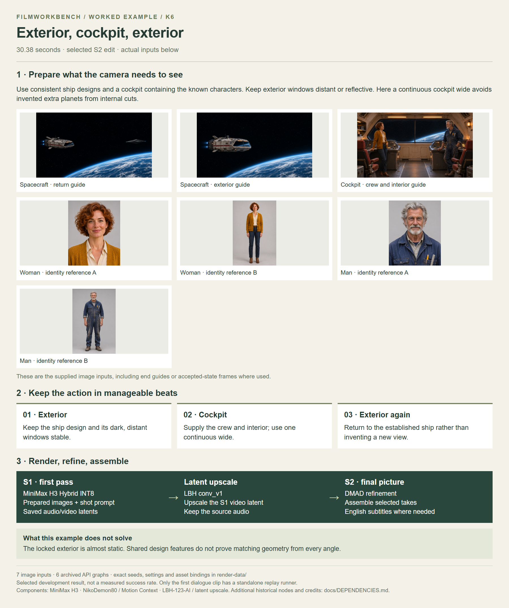
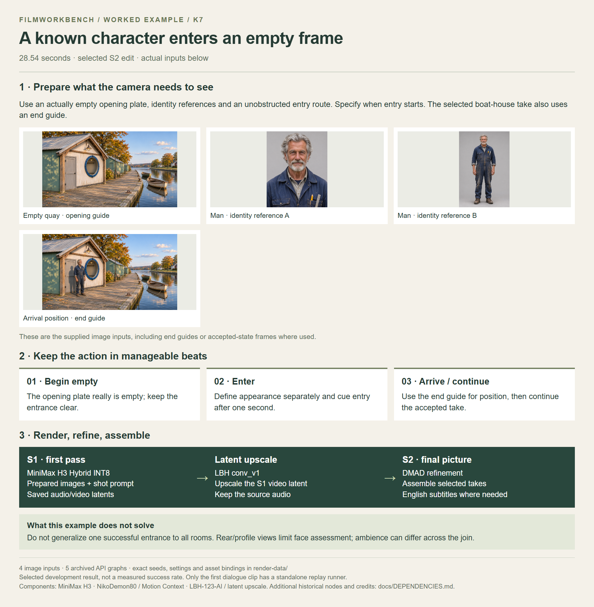
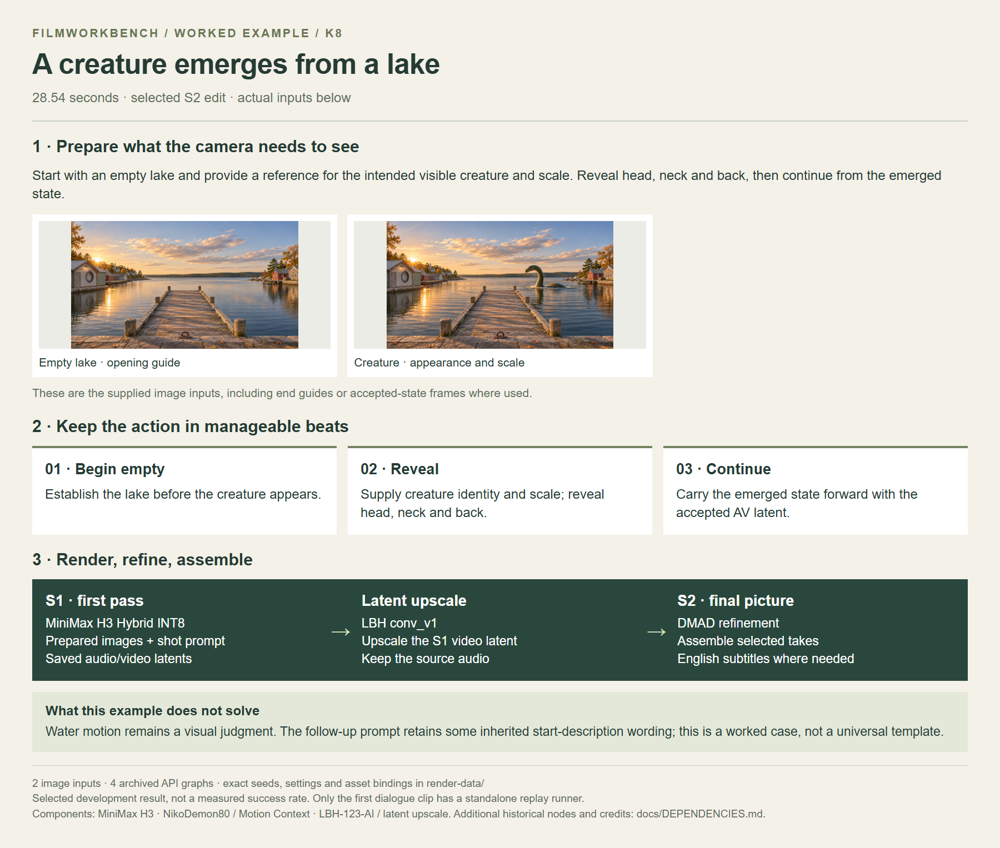
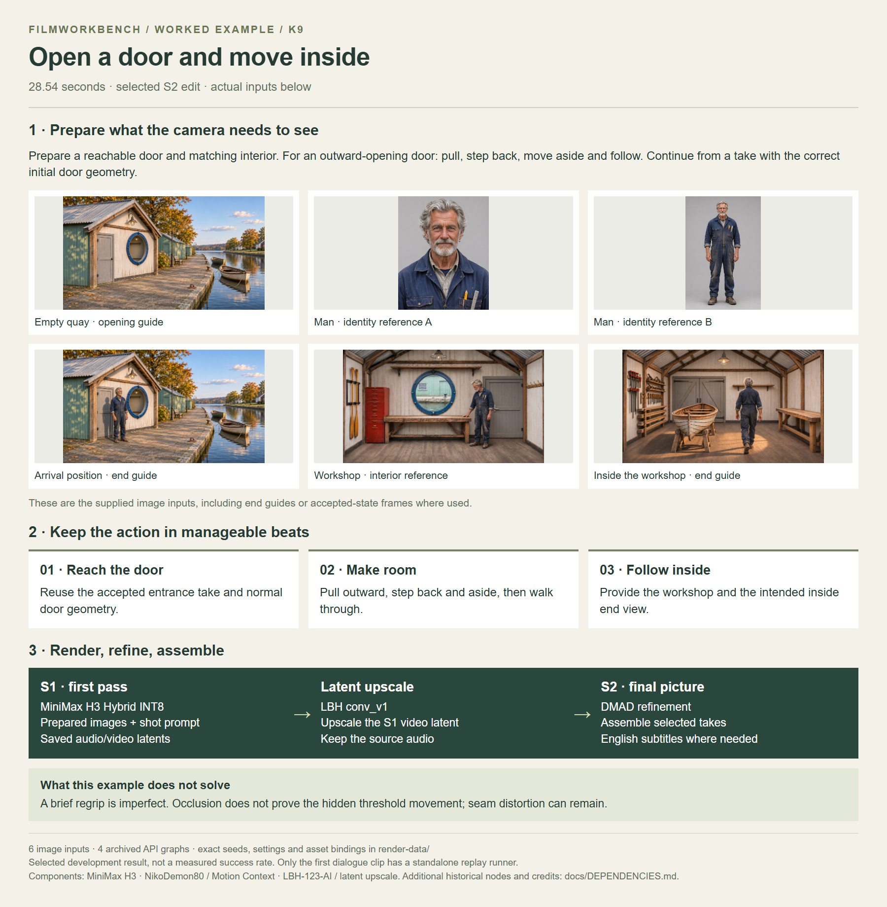
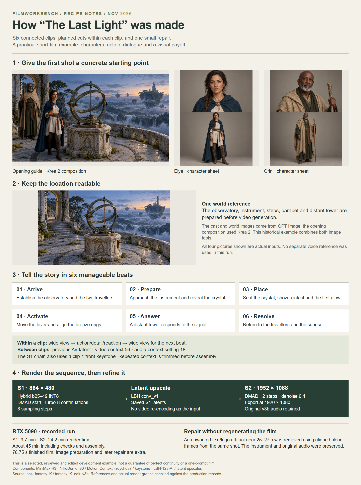

# Workflow examples

Open a case for its input/workflow overview and deeper render data, or download its finished S2 video directly. All videos are on [GitHub Releases](https://github.com/martinsommer3-oss/Filmworkbench-Starter/releases/tag/v0.1.0); no YouTube or Drive account is needed. The [complete video ZIP](https://github.com/martinsommer3-oss/Filmworkbench-Starter/releases/download/v0.1.0/Filmworkbench-v0.1-examples.zip) places the MP4s beside these overviews when extracted at the repository root.

| Case and source records | S2 video | Input/workflow overview |
| --- | --- | --- |
| [K1 — Dialogue with close-ups](K1/README.md) | [Download MP4](https://github.com/martinsommer3-oss/Filmworkbench-Starter/releases/download/v0.1.0/Filmworkbench_K1_S2.mp4) · 28.5s |  |
| [K2 — Reverse angle and return](K2/README.md) | [Download MP4](https://github.com/martinsommer3-oss/Filmworkbench-Starter/releases/download/v0.1.0/Filmworkbench_K2_S2.mp4) · 28.5s |  |
| [K3 — Leave and return to a changed state](K3/README.md) | [Download MP4](https://github.com/martinsommer3-oss/Filmworkbench-Starter/releases/download/v0.1.0/Filmworkbench_K3_S2.mp4) · 29.7s |  |
| [K4 — Establishing shot with an audio prelap](K4/README.md) | [Download MP4](https://github.com/martinsommer3-oss/Filmworkbench-Starter/releases/download/v0.1.0/Filmworkbench_K4_S2.mp4) · 30.4s |  |
| [K6 — Exterior, cockpit, exterior](K6/README.md) | [Download MP4](https://github.com/martinsommer3-oss/Filmworkbench-Starter/releases/download/v0.1.0/Filmworkbench_K6_S2.mp4) · 30.4s |  |
| [K7 — A known character enters an empty frame](K7/README.md) | [Download MP4](https://github.com/martinsommer3-oss/Filmworkbench-Starter/releases/download/v0.1.0/Filmworkbench_K7_S2.mp4) · 28.5s |  |
| [K8 — A creature emerges from a lake](K8/README.md) | [Download MP4](https://github.com/martinsommer3-oss/Filmworkbench-Starter/releases/download/v0.1.0/Filmworkbench_K8_S2.mp4) · 28.5s |  |
| [K9 — Open a door and move inside](K9/README.md) | [Download MP4](https://github.com/martinsommer3-oss/Filmworkbench-Starter/releases/download/v0.1.0/Filmworkbench_K9_S2.mp4) · 28.5s |  |
| [MARKET — Marketplace — arrival, purchase, orbit, departure](MARKET/README.md) | [Download MP4](https://github.com/martinsommer3-oss/Filmworkbench-Starter/releases/download/v0.1.0/Filmworkbench_MARKET_S2.mp4) · 49.7s |  |
| [FANTASY — The Last Light — six-clip Fantasy film](FANTASY/README.md) | [Download MP4](https://github.com/martinsommer3-oss/Filmworkbench-Starter/releases/download/v0.1.0/Filmworkbench_FANTASY_S2.mp4) · 78.8s |  |

[Try the runnable dialogue starter](../docs/QUICKSTART.md). The other cases are worked production examples, not automated full-chain replay programs.
