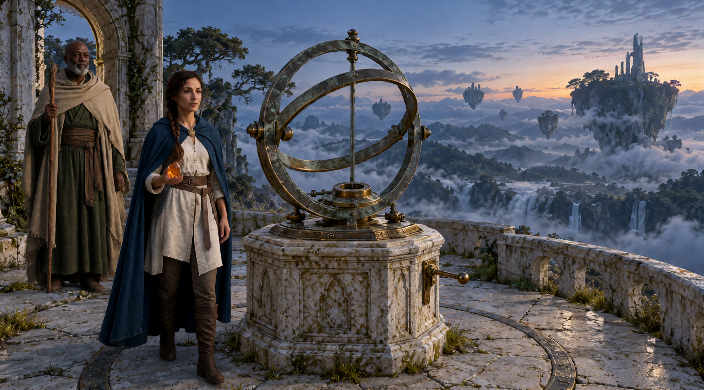
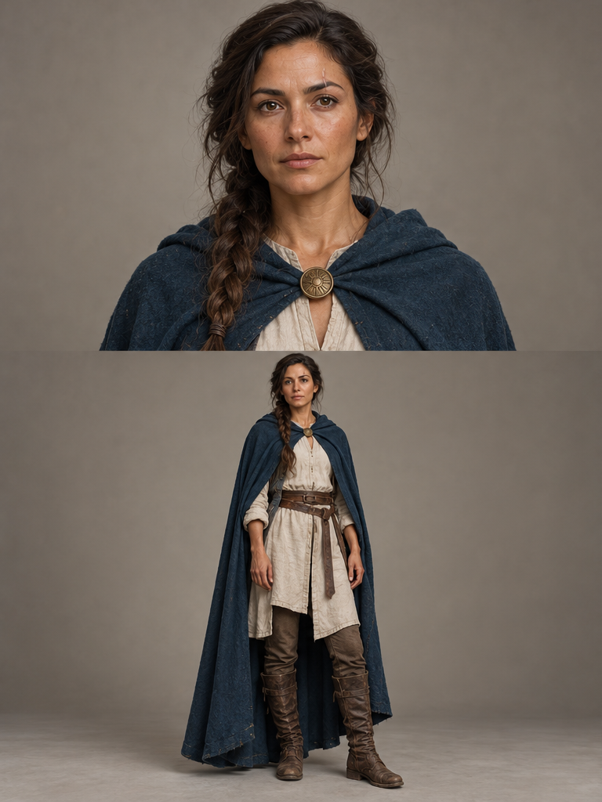
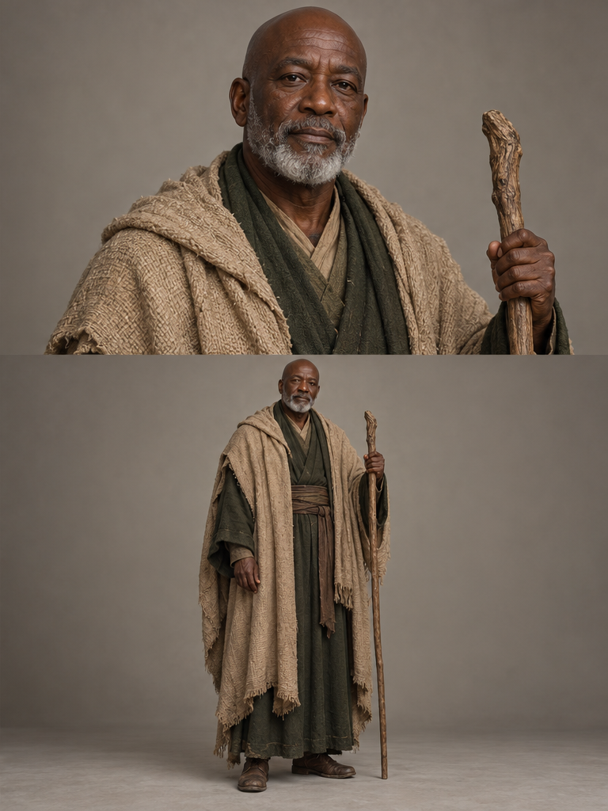
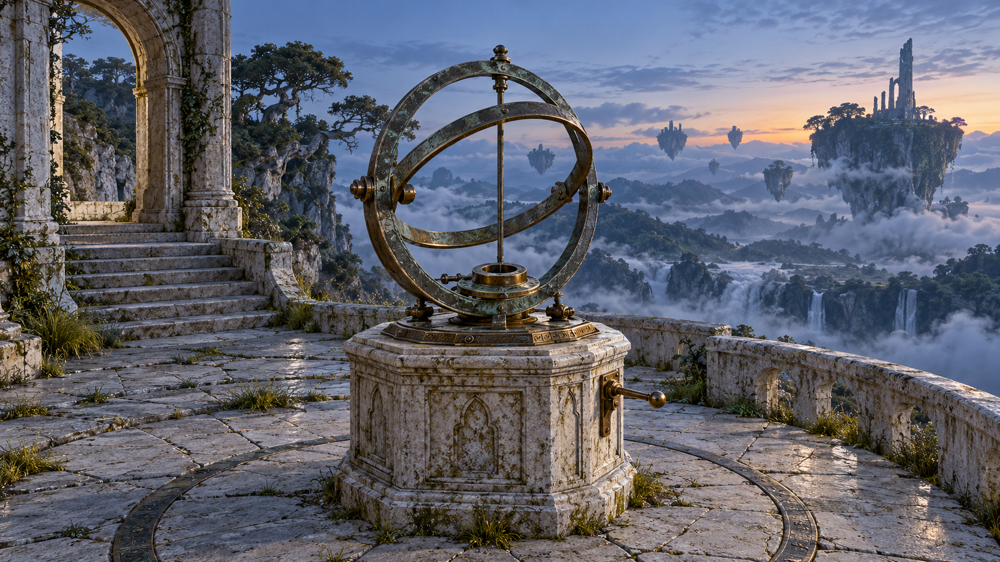

# The Last Light — Fantasy making-of

[Video and workflow overview](../examples/FANTASY/README.md)

[Watch the English-subtitled S2 film](https://github.com/martinsommer3-oss/Filmworkbench-Starter/releases/download/v0.1.0/Filmworkbench_FANTASY_S2.mp4) · 78.75 seconds · 1920×1080 · 24 fps

[Reference and workflow overview](../docs/fantasy_reference_overview.png) · [English SRT](../docs/fantasy_en.srt)

Six connected clips about two characters restarting an observatory. GPT Image supplied the world/character references; Krea 2 supplied the opening composition. This historical mixed-image workflow predates the newer preference for a coherent provider family.

H3 Hybrid b25–49 INT8; S1 864×480, eight steps; learned latent upscale and two-step DMAD S2 at 1952×1088 before the final 1080p edit. Continuations used 56 video and 18 audio context frames and a first-clip S1 keystone. This older film retains its selected S2 audio; it is not silently switched to the newer S1-audio policy.

Recorded S1/S2 render times total about 34 minutes on the RTX 5090. The pipeline took about 45 minutes including checks and assembly; image preparation and later repairs are excluded. The chosen v3b edit uses an aligned clean-plate repair for a short unwanted logo artifact on the instrument. It is not an untouched one-prompt output.

This page supplies the actual four image references and production breakdown. The complete Fantasy replay and clean-plate editor are not packaged in the starter. The runnable example is the first K1 dialogue clip; the 44 archival graphs cover the eight scene recipes and marketplace.

## Input references

**Opening composition (Krea 2)**

**Elya character sheet**

**Orin character sheet**

**World reference (GPT Image)**

