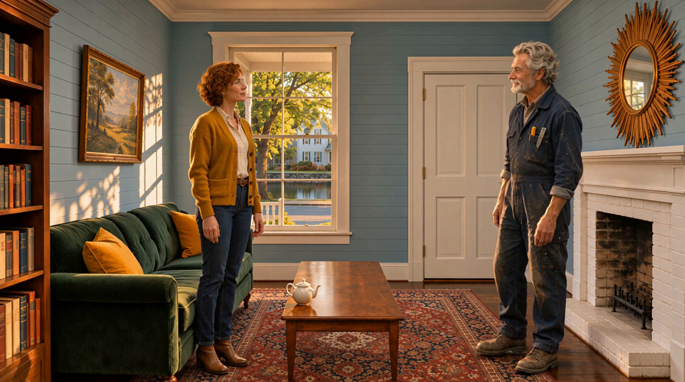
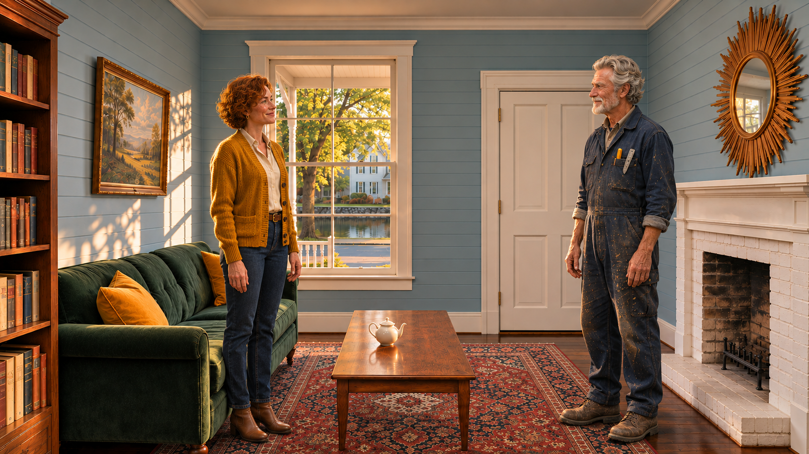
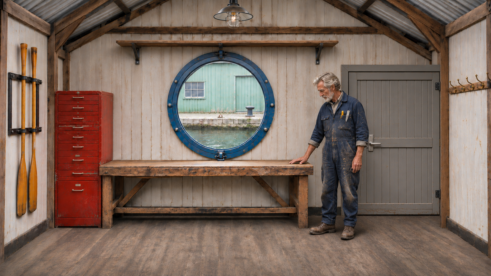

# K3 — Leave and return to a changed state

[Video and workflow overview](../examples/K3/README.md)

[Watch the S2 example](https://github.com/martinsommer3-oss/Filmworkbench-Starter/releases/download/v0.1.0/Filmworkbench_K3_S2.mp4) · 29.67 seconds · 1952×1088 · 24 fps

## Recipe

Show the prop move, cut to another location, then use the actual accepted end frame as the return start. Preserve the new prop position.

## Known limits

The state is supplied explicitly; this is not free persistent model memory. Hand contact remains a separate question.

This is a selected development example with positive user feedback, not a measured success rate. The feedback file predates some bookkeeping updates; no new blanket approval of every variant is implied.

## Actual rendered inputs

- [K3_RETURN S1](../graphs/K3_RETURN_S1.api.json)
- [K3_RETURN S2](../graphs/K3_RETURN_S2.api.json)
- [K3_ROOM1 S1](../graphs/K3_ROOM1_S1.api.json)
- [K3_ROOM1 S2](../graphs/K3_ROOM1_S2.api.json)
- [K3_WORKSHOP S1](../graphs/K3_WORKSHOP_S1.api.json)
- [K3_WORKSHOP S2](../graphs/K3_WORKSHOP_S2.api.json)

[Assembly and audio sources](K3_assembly.json). Graphs use the ComfyUI API format, not a visual-editor layout. Their companion bindings files identify included reference stills. Chained graphs require their recorded predecessor latents; those large runtime files are not distributed. Use `film.py` for the full chain, own inputs and guided approvals; see [guided filmmaking](../docs/GUIDED_FILM.md).

English dialogue subtitles are burned into the selected release video. [SRT source](../subtitles/K3.en.srt). The assembly record hashes the original unsubtitled edit; [subtitle validation](../docs/subtitle_validation.json) binds its translated derivative.

## Included reference files

Open a reference to download it at full resolution. Bindings identify the loader nodes; the prompts specify the picture roles.

Used by: `K3_RETURN_S1:sl1`, `K3_RETURN_S1:night_ref0`, `K3_RETURN_S2:sl2`, `K3_RETURN_S2:night_ref0`

Used by: `K3_RETURN_S1:night_ref1`, `K3_RETURN_S2:night_ref1`, `K3_ROOM1_S1:night_ref1`, `K3_ROOM1_S2:night_ref1`

Used by: `K3_RETURN_S1:night_ref2`, `K3_RETURN_S2:night_ref2`, `K3_ROOM1_S1:night_ref2`, `K3_ROOM1_S2:night_ref2`

Used by: `K3_RETURN_S1:night_ref3`, `K3_RETURN_S2:night_ref3`, `K3_ROOM1_S1:night_ref3`, `K3_ROOM1_S2:night_ref3`, `K3_WORKSHOP_S1:night_ref1`, `K3_WORKSHOP_S2:night_ref1`

Used by: `K3_RETURN_S1:night_ref4`, `K3_RETURN_S2:night_ref4`, `K3_ROOM1_S1:night_ref4`, `K3_ROOM1_S2:night_ref4`, `K3_WORKSHOP_S1:night_ref2`, `K3_WORKSHOP_S2:night_ref2`

Used by: `K3_ROOM1_S1:sl1`, `K3_ROOM1_S1:night_ref0`, `K3_ROOM1_S2:sl2`, `K3_ROOM1_S2:night_ref0`

Used by: `K3_WORKSHOP_S1:sl1`, `K3_WORKSHOP_S1:night_ref0`, `K3_WORKSHOP_S2:sl2`, `K3_WORKSHOP_S2:night_ref0`
