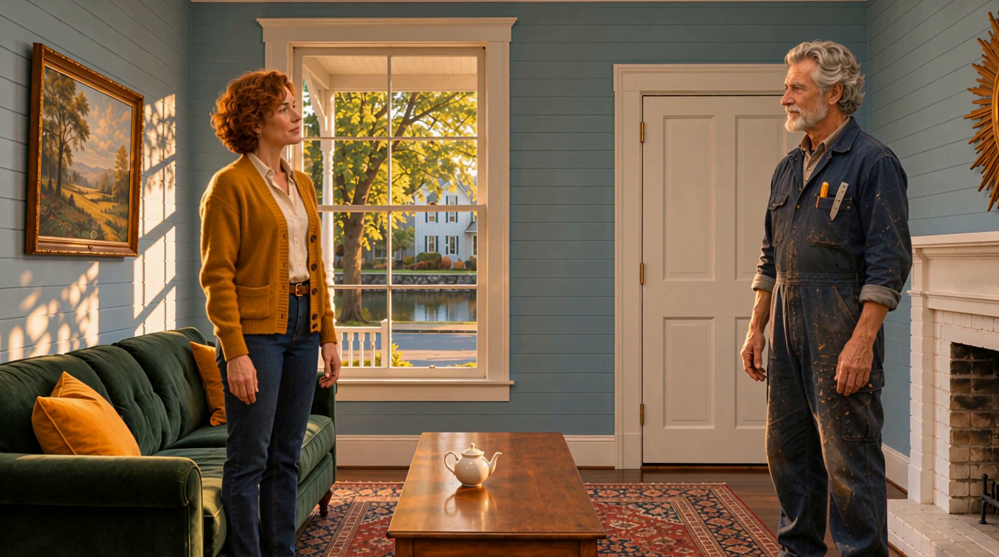

# K4 — Establishing shot with an audio prelap

[Video and workflow overview](../examples/K4/README.md)

[Watch the S2 example](https://github.com/martinsommer3-oss/Filmworkbench-Starter/releases/download/v0.1.0/Filmworkbench_K4_S2.mp4) · 30.38 seconds · 1952×1088 · 24 fps

## Recipe

Prepare a matching exterior and interior. Start the first dialogue line before the cut inside. This example uses a Qwen-generated prelap and a fresh final shot after word repetition in chained alternatives.

## Known limits

The upward exterior move is less useful than the intended approach. Audio references can cause repeated words; listen to the complete transition.

This is a selected development example with positive user feedback, not a measured success rate. The feedback file predates some bookkeeping updates; no new blanket approval of every variant is implied.

## Actual rendered inputs

- [K4_EXT S1](../graphs/K4_EXT_S1.api.json)
- [K4_EXT S2](../graphs/K4_EXT_S2.api.json)
- [K4_FRESH S1](../graphs/K4_FRESH_S1.api.json)
- [K4_FRESH S2](../graphs/K4_FRESH_S2.api.json)
- [K4_INT_AUDIO S1](../graphs/K4_INT_AUDIO_S1.api.json)
- [K4_INT_AUDIO S2](../graphs/K4_INT_AUDIO_S2.api.json)

[Assembly and audio sources](K4_assembly.json). Graphs use the ComfyUI API format, not a visual-editor layout. Their companion bindings files identify included reference stills. Chained graphs require their recorded predecessor latents; those large runtime files are not distributed. Use `film.py` for the full chain, own inputs and guided approvals; see [guided filmmaking](../docs/GUIDED_FILM.md).

English dialogue subtitles are burned into the selected release video. [SRT source](../subtitles/K4.en.srt). The assembly record hashes the original unsubtitled edit; [subtitle validation](../docs/subtitle_validation.json) binds its translated derivative.

## Included reference files

Open a reference to download it at full resolution. Bindings identify the loader nodes; the prompts specify the picture roles.

Used by: `K4_EXT_S1:sl1`, `K4_EXT_S1:night_ref0`, `K4_EXT_S2:sl2`, `K4_EXT_S2:night_ref0`

Used by: `K4_FRESH_S1:sl1`, `K4_FRESH_S1:night_ref0`, `K4_FRESH_S2:sl2`, `K4_FRESH_S2:night_ref0`

Used by: `K4_FRESH_S1:night_ref1`, `K4_FRESH_S2:night_ref1`, `K4_INT_AUDIO_S1:night_ref1`, `K4_INT_AUDIO_S2:night_ref1`

Used by: `K4_FRESH_S1:night_ref2`, `K4_FRESH_S2:night_ref2`, `K4_INT_AUDIO_S1:night_ref2`, `K4_INT_AUDIO_S2:night_ref2`

Used by: `K4_FRESH_S1:night_ref3`, `K4_FRESH_S2:night_ref3`, `K4_INT_AUDIO_S1:night_ref3`, `K4_INT_AUDIO_S2:night_ref3`

Used by: `K4_FRESH_S1:night_ref4`, `K4_FRESH_S2:night_ref4`, `K4_INT_AUDIO_S1:night_ref4`, `K4_INT_AUDIO_S2:night_ref4`

Used by: `K4_INT_AUDIO_S1:sl1`, `K4_INT_AUDIO_S1:night_ref0`, `K4_INT_AUDIO_S2:sl2`, `K4_INT_AUDIO_S2:night_ref0`

[Audio input 1a75cd2e591a68ec.wav](../assets/1a75cd2e591a68ec.wav)

Used by: `K4_INT_AUDIO_S1:night_audio`, `K4_INT_AUDIO_S2:night_audio`
