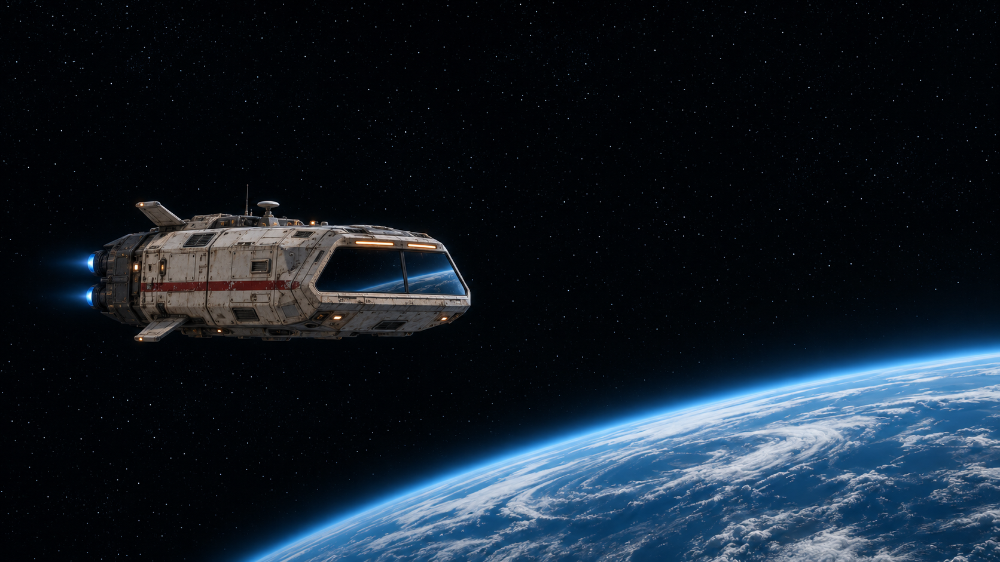
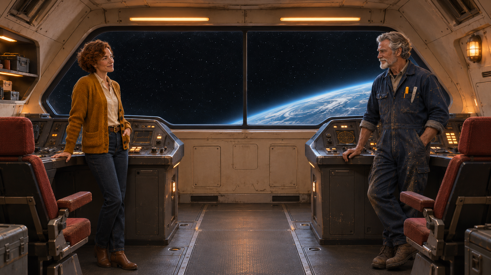
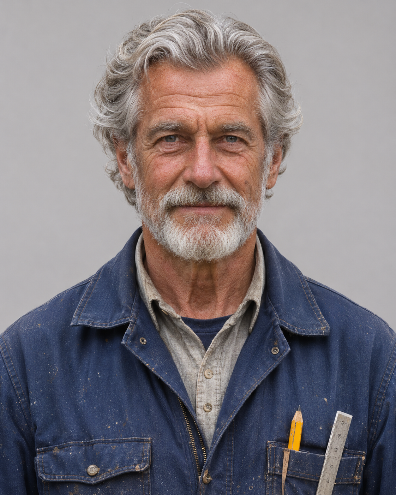
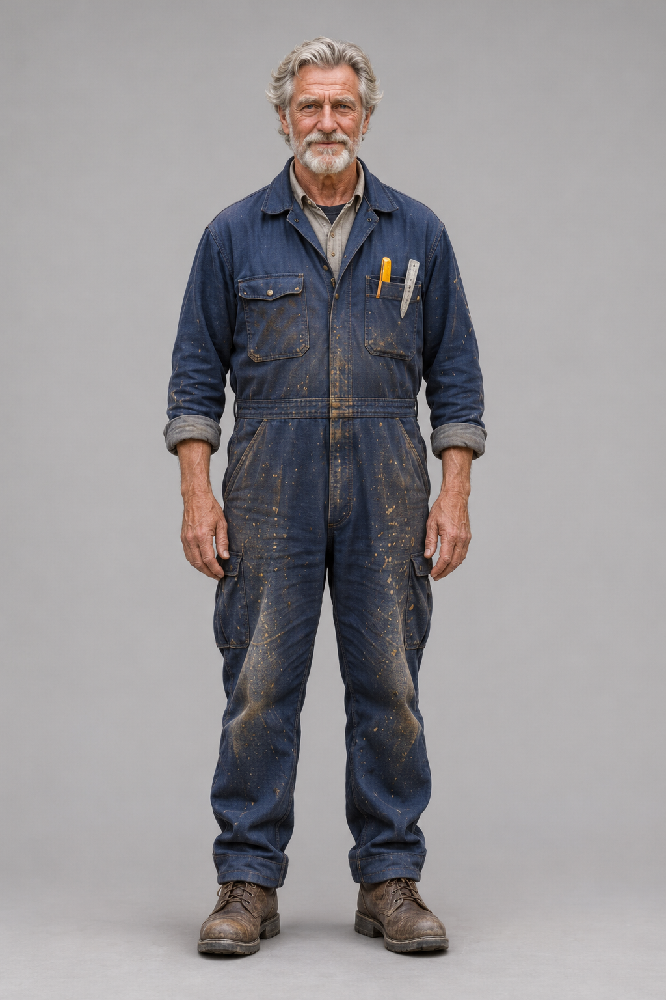

# K6 — Exterior, cockpit, exterior

[Video and workflow overview](../examples/K6/README.md)

[Watch the S2 example](https://github.com/martinsommer3-oss/Filmworkbench-Starter/releases/download/v0.1.0/Filmworkbench_K6_S2.mp4) · 30.38 seconds · 1952×1088 · 24 fps

## Recipe

Use consistent ship designs and a cockpit containing the known characters. Keep exterior windows distant or reflective. Here a continuous cockpit wide avoids invented extra planets from internal cuts.

## Known limits

The locked exterior is almost static. Shared design features do not prove matching geometry from every angle.

This is a selected development example with positive user feedback, not a measured success rate. The feedback file predates some bookkeeping updates; no new blanket approval of every variant is implied.

## Actual rendered inputs

- [K6_EXT2 S1](../graphs/K6_EXT2_S1.api.json)
- [K6_EXT2 S2](../graphs/K6_EXT2_S2.api.json)
- [K6_EXT_LOCK S1](../graphs/K6_EXT_LOCK_S1.api.json)
- [K6_EXT_LOCK S2](../graphs/K6_EXT_LOCK_S2.api.json)
- [K6_INT_WIDE S1](../graphs/K6_INT_WIDE_S1.api.json)
- [K6_INT_WIDE S2](../graphs/K6_INT_WIDE_S2.api.json)

[Assembly and audio sources](K6_assembly.json). Graphs use the ComfyUI API format, not a visual-editor layout. Their companion bindings files identify included reference stills. Chained graphs require their recorded predecessor latents; those large runtime files are not distributed. The runnable starter covers the first dialogue clip only.

English dialogue subtitles are burned into the selected release video. [SRT source](../subtitles/K6.en.srt). The assembly record hashes the original unsubtitled edit; [subtitle validation](../docs/subtitle_validation.json) binds its translated derivative.

## Included reference files

Open a reference to download it at full resolution. Bindings identify the loader nodes; the prompts specify the picture roles.

Used by: `K6_EXT2_S1:sl1`, `K6_EXT2_S1:night_ref0`, `K6_EXT2_S2:sl2`, `K6_EXT2_S2:night_ref0`

Used by: `K6_EXT_LOCK_S1:sl1`, `K6_EXT_LOCK_S1:night_ref0`, `K6_EXT_LOCK_S1:night_end`, `K6_EXT_LOCK_S2:sl2`, `K6_EXT_LOCK_S2:night_ref0`, `K6_EXT_LOCK_S2:night_end`

Used by: `K6_INT_WIDE_S1:sl1`, `K6_INT_WIDE_S1:night_ref0`, `K6_INT_WIDE_S2:sl2`, `K6_INT_WIDE_S2:night_ref0`

Used by: `K6_INT_WIDE_S1:night_ref1`, `K6_INT_WIDE_S2:night_ref1`

Used by: `K6_INT_WIDE_S1:night_ref2`, `K6_INT_WIDE_S2:night_ref2`

Used by: `K6_INT_WIDE_S1:night_ref3`, `K6_INT_WIDE_S2:night_ref3`

Used by: `K6_INT_WIDE_S1:night_ref4`, `K6_INT_WIDE_S2:night_ref4`
