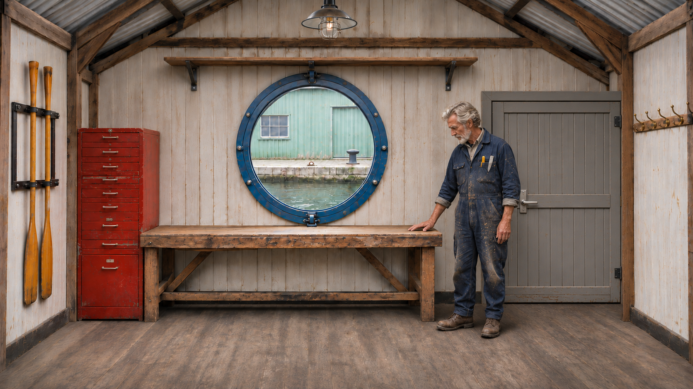
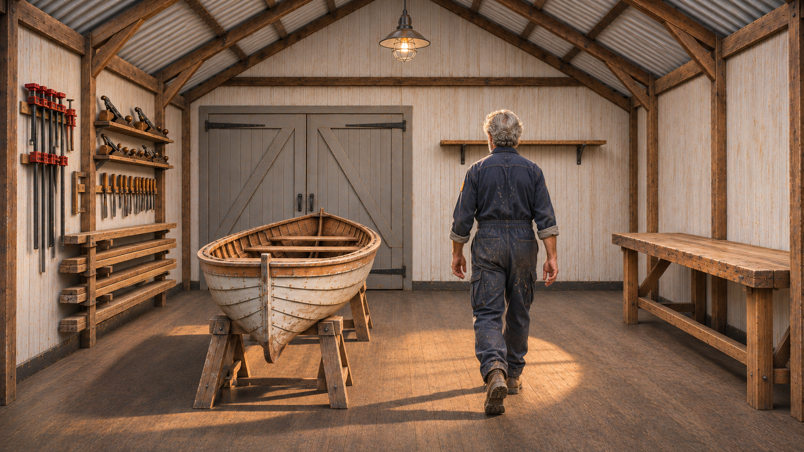

# K9 — Open a door and move inside

[Video and workflow overview](../examples/K9/README.md)

[Watch the S2 example](https://github.com/martinsommer3-oss/Filmworkbench-Starter/releases/download/v0.1.0/Filmworkbench_K9_S2.mp4) · 28.54 seconds · 1952×1088 · 24 fps

## Recipe

Prepare a reachable door and matching interior. For an outward-opening door: pull, step back, move aside and follow. Continue from a take with the correct initial door geometry.

## Known limits

A brief regrip is imperfect. Occlusion does not prove the hidden threshold movement; seam distortion can remain.

This is a selected development example with positive user feedback, not a measured success rate. The feedback file predates some bookkeeping updates; no new blanket approval of every variant is implied.

## Actual rendered inputs

- [K7_END S1](../graphs/K7_END_S1.api.json)
- [K7_END S2](../graphs/K7_END_S2.api.json)
- [K9_FROM_ENTRY S1](../graphs/K9_FROM_ENTRY_S1.api.json)
- [K9_FROM_ENTRY S2](../graphs/K9_FROM_ENTRY_S2.api.json)

[Assembly and audio sources](K9_assembly.json). Graphs use the ComfyUI API format, not a visual-editor layout. Their companion bindings files identify included reference stills. Chained graphs require their recorded predecessor latents; those large runtime files are not distributed. The runnable starter covers the first dialogue clip only.

## Included reference files

Open a reference to download it at full resolution. Bindings identify the loader nodes; the prompts specify the picture roles.

Used by: `K7_END_S1:sl1`, `K7_END_S1:night_ref0`, `K7_END_S2:sl2`, `K7_END_S2:night_ref0`

Used by: `K7_END_S1:night_ref1`, `K7_END_S2:night_ref1`, `K9_FROM_ENTRY_S1:night_ref0`, `K9_FROM_ENTRY_S2:night_ref0`

Used by: `K7_END_S1:night_ref2`, `K7_END_S2:night_ref2`, `K9_FROM_ENTRY_S1:night_ref1`, `K9_FROM_ENTRY_S2:night_ref1`

Used by: `K7_END_S1:night_end`, `K7_END_S2:night_end`

Used by: `K9_FROM_ENTRY_S1:night_ref2`, `K9_FROM_ENTRY_S2:night_ref2`

Used by: `K9_FROM_ENTRY_S1:night_end`, `K9_FROM_ENTRY_S2:night_end`
